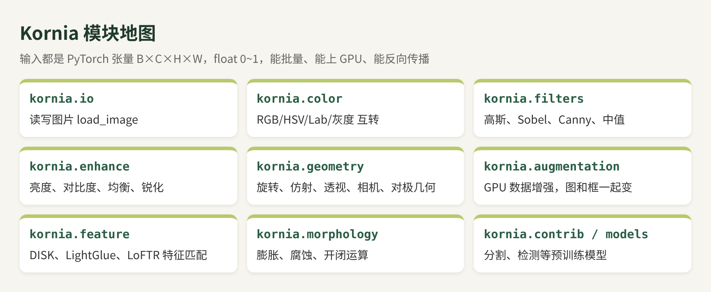
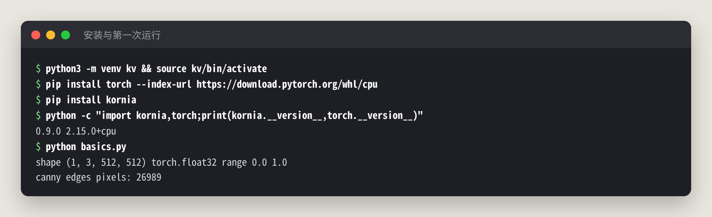
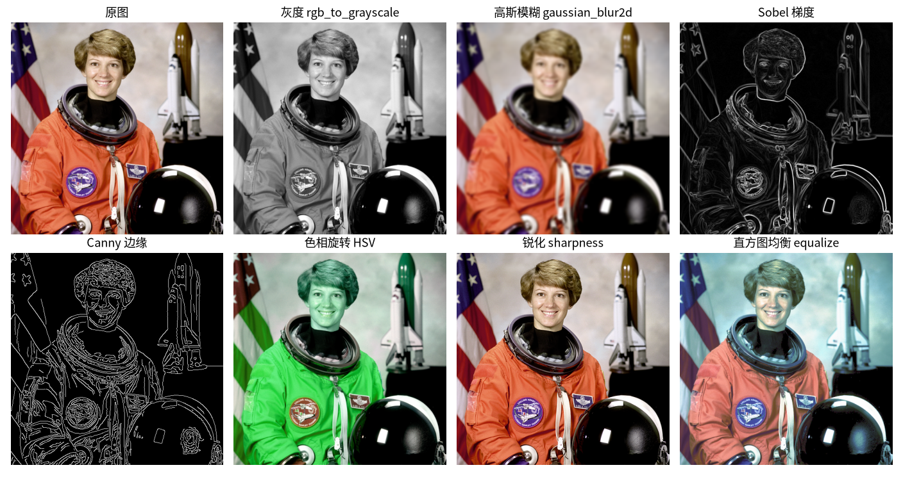
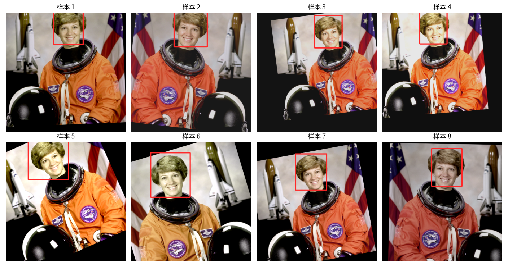

# Kornia 中文教程：把 OpenCV 搬进 PyTorch，图像处理也能求梯度（CPU 实测）

> **非官方中文教程**。原项目 [kornia/kornia](https://github.com/kornia/kornia)（Apache-2.0），本仓库与原作者无关。

📚 免费版讲“是什么、和 OpenCV 有什么不同、怎么装、第一次运行、数据增强”。完整版（可微分优化、DISK+LightGlue 特征匹配、CPU 速度实测、局限和踩坑、全部脚本）在知识星球「开源抢先站」：[https://t.zsxq.com/mc4td](https://t.zsxq.com/mc4td)

🎟️ 首发 6 折：新人先领 20 元券，50 元变 30 元（限 50 张，11 月 29 日截止）👉 [领券](https://t.zsxq.com/jk0TT)
>
> 适用版本：kornia `0.9.0` + PyTorch `2.15.0+cpu`｜实测日期：2026-11-02｜实测环境：Linux x86_64，8 核 CPU，无 GPU，Python 3.13
> 文中终端输出和图片都来自真机实测。没实测的部分标了「⚠️ 未实测」。

## 0. 先说结论：值不值得用？

Kornia 是一个“长在 PyTorch 里的 OpenCV”：滤波、颜色转换、几何变换、数据增强、特征匹配，全都写成了 PyTorch 算子。GitHub 1.1 万星，最近又上了热榜。

我的实测结论：

- **最大卖点是“可微分”。** 图像变换能反向传播。第 4 节我只写了 15 行，用梯度下降从一张被旋转的图里找回了旋转角：真实 17°，找回 17.01°。这在 OpenCV 里做不到。
- **数据增强很顺手。** 一张图复制成 8 张，一次调用做完翻转、仿射和颜色抖动，**框会跟着图一起变**（第 3 节）。
- **特征匹配开箱即用。** DISK + LightGlue 自动下载权重，CPU 上 1.04 秒匹配出 1223 对点。估计出的单应矩阵和真值误差不到 0.4 像素（第 5 节）。
- **别指望它在 CPU 上比 OpenCV 快。** 64 张图批量处理，只有转灰度 Kornia 更快。高斯模糊慢 2.4 倍，Canny 慢 30 多倍（第 6 节）。它的优势在 GPU、批量和训练流水线里。

一句话：**做深度学习训练、需要在模型里做图像处理或求梯度，选 Kornia；纯 CPU 上处理单张图，继续用 OpenCV。**

## 1. 它是什么？



和 OpenCV 最大的区别是数据格式：Kornia 的输入输出都是 **`B×C×H×W` 的 float 张量，取值 0~1**。也就是说它天然支持批量，`.cuda()` 一下就能上 GPU，还能接进 `nn.Module` 一起训练。

| 对比项 | OpenCV | Kornia |
|---|---|---|
| 数据格式 | NumPy，H×W×C，uint8，BGR | PyTorch 张量，B×C×H×W，float，RGB |
| 批量 | 自己写循环 | 原生支持 |
| GPU | 要单独编译 CUDA 版 | `.to('cuda')` 即可 |
| 反向传播 | 不支持 | 支持 |
| 单张图 CPU 速度 | 快 | 慢一些 |
| 许可 | Apache-2.0 | Apache-2.0 |

## 2. 安装和第一次运行

没有 GPU 的话，先装 CPU 版 PyTorch，体积小很多。然后装 kornia：

```bash
python3 -m venv kv && source kv/bin/activate
pip install torch --index-url https://download.pytorch.org/whl/cpu
pip install kornia
```

有 NVIDIA 显卡就按 pytorch.org 的命令装 CUDA 版 PyTorch（⚠️ 未实测 GPU）。



第一个脚本 `basics.py`，读图后做 7 种常见处理：

```python
import kornia as K
img = K.io.load_image('astro.png', K.io.ImageLoadType.RGB32)[None]  # 1×3×512×512
gray  = K.color.rgb_to_grayscale(img)
blur  = K.filters.gaussian_blur2d(img, (9, 9), (3., 3.))
sobel = K.filters.sobel(gray)
mag, edges = K.filters.canny(gray)
sharp = K.enhance.sharpness(img, 2.0)
eq    = K.enhance.equalize(img)
```



> 注意末尾的 `[None]`：`load_image` 返回 `C×H×W`，Kornia 大部分函数要 `B×C×H×W`，需要补一个批次维。漏了这一步是新手最常见的报错。

## 3. 数据增强：图和框一起变

训练检测模型时，图片旋转了，标注框也得跟着转。Kornia 的 `AugmentationSequential` 用 `data_keys` 声明要同步变换哪些东西：

```python
import kornia.augmentation as KA
aug = KA.AugmentationSequential(
    KA.RandomHorizontalFlip(p=0.5),
    KA.RandomAffine(degrees=25, translate=(0.1, 0.1), scale=(0.8, 1.1), p=1.0),
    KA.ColorJitter(0.3, 0.3, 0.3, 0.05, p=0.8),
    data_keys=['input', 'bbox'])
batch = img.repeat(8, 1, 1, 1)                 # 8×3×512×512
boxes = box[None].repeat(8, 1, 1, 1)           # 8×1×4×2（每个框 4 个角点）
out, out_boxes = aug(batch, boxes)
```



> 踩坑：框的形状必须是 `B×N×4×2`。我一开始传了 `B×4×2`，报错 `Batch size mismatch. Got 1 for boxes and 8 for the transformation matrix`，多加一维就好了。另外框转出画面后坐标会变负数（实测样本 1 的框 y 到了 -19），用之前要自己裁剪。

## 4. 完整版还讲了什么

| 章节 | 一句话简介 |
|---|---|
| 可微分优化 | 15 行代码用梯度下降找回旋转角（真值 17°，找回 17.01°），以及能用在哪 |
| 特征匹配 | DISK + LightGlue 1.04 秒匹配 1223 对点，单应估计误差不到 0.4 像素，权重下载注意事项 |
| 速度实测 | 64 张图 CPU 上 Kornia 对 OpenCV：哪个快、快多少、为什么 |
| 局限和踩坑 | 形状、取值范围、BGR/RGB、告警、新旧 API |
| 实测清单 | 哪些测了、哪些没测 |

---

## 加入知识星球「开源抢先站」看完整版

[https://t.zsxq.com/mc4td](https://t.zsxq.com/mc4td)


**微信扫码加入星球，先领 20 元券**

🎟️ 首发 6 折新人券（20 元，50 元变 30 元，限 50 张，2026-11-29 截止）：[https://t.zsxq.com/jk0TT](https://t.zsxq.com/jk0TT)

---

## 来源与许可

- 原项目：https://github.com/kornia/kornia ，采用 **Apache License 2.0**，版权归 Kornia 作者团队。本教程是独立撰写的非官方使用教程，与 Kornia 没有隶属或背书关系；引用的 API 名称属于原项目。
- 测试图片 astronaut（NASA，公有领域）和 coffee 来自 scikit-image 自带样例数据。
- DISK、LightGlue 模型权重由各自作者发布，经 Kornia 的 HuggingFace 仓库下载，使用时请遵守其许可。
- 本教程的文字与图片采用 CC BY-NC-SA 4.0 许可。
